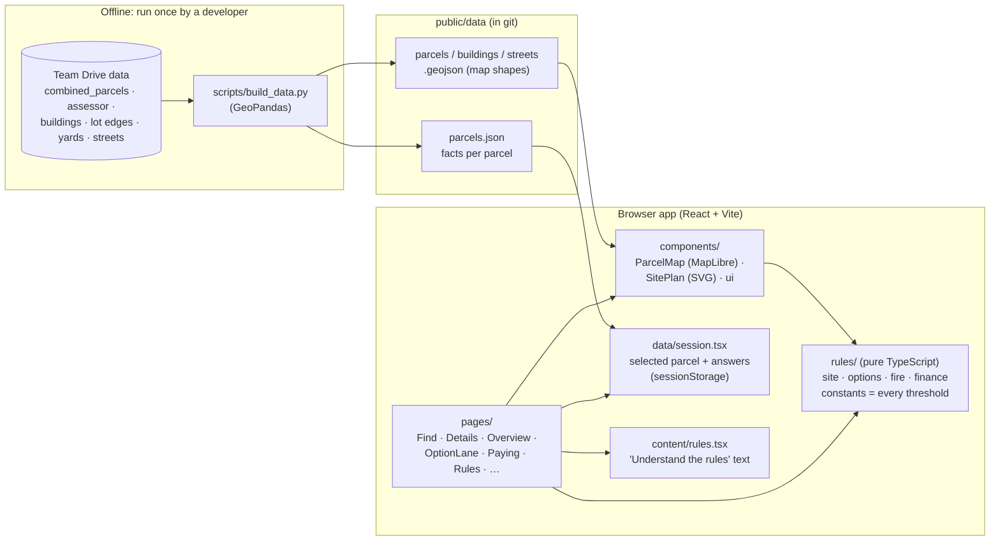

# Boston ADU Explorer: web prototype

A web tool that helps Mattapan homeowners see whether they could add an **accessory dwelling unit (ADU)**, and which
of the Boston ADU Guidebook designs might fit their lot.

> **MIT student prototype, not an official City of Boston service.** Results are preliminary and based on public data
> and the user's answers. They are not a zoning determination, permit or legal advice.

**Live site:** `https://crowd-sourced-city.github.io/rehousing-mattapan/` (from `main`). Each pull request also gets a
preview link; see [CI/CD](#cicd).

## What it does

1. **Find your property.** Search an address or click a lot on the map. The map is coloured by whether the tool can
   check that lot.
2. **Property details.** City data is filled in for each lot: zoning, lot size, house size, yards, flood zone and so
   on. The owner adds what the data can't know, such as owner-occupancy, number of units, attic, basement, garage and
   sprinklers.
3. **Site check.** Article 60's dimensional rules for lots adding an ADU (coverage, yards, height, unit count).
   Failing lots see an "ADU not possible as-of-right" screen that says why. Lots the tool can't assess yet, such as
   irregular lots or condos, see their own stop screen.
4. **Options overview.** The Guidebook designs for the lot's size group:
   - small lots: 5 designs
   - medium lots: 4 designs
   - large lots: 6 designs

   Each design gets an early status from city data alone: *Looks possible*, *More information needed*, *Closer look
   needed* or *Not supported*.
5. **Option lane: Explore → Questions → Result.** Two or three questions per design give a result with:
   - a status and the most important factor
   - key numbers and a site-plan diagram drawn to the lot's dimensions
   - the reasons behind the result and next steps
   - "How we reached this result": every check, in order, with its source
   - "Understand the rules" explainers
6. **Help paying.** Eligibility for the City's ADU loan program, checked against the 135% AMI income table.
7. **Prepare for a professional.** A printable one-page summary.

Every rule and threshold comes from the Article 60 fact sheet, the City's ADU fire-safety guidance, the Boston ADU
Guidebook or the team's Miro decision tree. Where they disagree or leave a gap, the decision is recorded:

- **[ASSUMPTIONS.md](ASSUMPTIONS.md)**: decisions and assumptions behind the results (⚠️ = important to check).
- **[OPEN_QUESTIONS.md](OPEN_QUESTIONS.md)**: bigger unresolved questions to revisit with the team.

## Architecture

There is **no server**. A Python script prepares the parcel data once, offline. Everything else is a static site that
runs in the browser and only looks things up.



| Layer | What's in it |
|---|---|
| `scripts/build_data.py` | Joins the team's GeoPackages and works out extra fields per parcel, including: both side yards (left/right as seen from the street); garage detection and position; buildable areas for attached and detached ADUs; the spot where a backyard ADU fits. Writes `public/data/`. Drops owner names and mailing addresses. |
| `src/rules/` | **The rules engine.** Pure functions, no React, so it's easy to test. `site.ts` covers scope, the Article 60 site check, lot-size groups and map colours. `options.ts` defines the 11 designs (questions, early status, full evaluation). `fire.ts` handles fire access and sprinklers; `finance.ts` handles loan eligibility. `constants.ts` holds every number, with its source. |
| `src/pages/` | One file per screen; routes live in `main.tsx`. Hash routing (`#/options`), so links work on GitHub Pages without server config. Each page's code downloads only when it's opened. The landing page ships with the app, and the ~1 MB map library is fetched only by the Find page. |
| `src/components/` | `ParcelMap`: MapLibre drawing only our own GeoJSON, with no basemap tiles or API keys. `SitePlan`: an SVG diagram scaled to the lot. `ui`: badges, questions, dropdowns, overlays. `ErrorScreen`: shown instead of a blank page if anything fails, with a **Developer Info** dropdown (error, stack, page, build, browser) and a copy button. |
| `src/boot.js` | Inlined into each page's `<head>` at build time. Before the app starts, it catches files that fail to load or early crashes and shows the same error screen in plain HTML. Each page also has a static "Loading…" message until the app replaces it. |
| `src/data/session.tsx` | Loads `parcels.json` once and keeps the selected parcel and answers in `sessionStorage` for the tab. Help-paying answers are never saved. |
| `src/content/` | Plain-language "Understand the rules" explainers. |

**Changing a rule:** edit the number in `src/rules/constants.ts`, or the logic in `src/rules/options.ts`. Then run
`npm test` and add an entry to `ASSUMPTIONS.md` if the change affects results.

## Running locally

Requires Node 20+.

```bash
cd web
npm install
npm run dev          # http://localhost:5173
```

Other scripts:

| Command | What it does |
|---|---|
| `npm test` | Unit tests (Vitest), about 2 s |
| `npm run build` | Production build into `dist/`. Uses relative paths, so it works from any sub-folder. |
| `npm run test:e2e` | Browser smoke tests (Playwright) against the build. Run `npm run build` first. First time only: `npx playwright install chromium`. |
| `npm run test:all` | Unit tests, build, then browser tests |
| `BASE_URL=<url> npm run test:e2e` | Browser tests against a deployed site, such as a PR preview |

### Rebuilding the data

Only needed when the team's source data changes. Run from the repository root:

```bash
python -m venv .venv-web && .venv-web/bin/pip install geopandas shapely pyproj
.venv-web/bin/python web/scripts/build_data.py --drive "/path/to/11_458_ProjectFolder_2026"
```

The script reads from the shared project Drive's `Data/` folder and takes about 15 s. Commit the updated
`web/public/data/` files, and re-run `npm test`, since the dataset tests run against the real data.

## Tests

| Suite | File | What it checks |
|---|---|---|
| Rules | `src/rules/rules.test.ts` | Hand-picked cases, including the spreadsheet's test parcels: lot-size groups, coverage limits, site check, fire access, key option outcomes, help-paying limits. |
| Whole-dataset sweep | `src/rules/dataset.test.ts` | Every supported parcel × every design for its lot size × every answer (over 50,000 evaluations). Nothing crashes, every status is valid, and no text shows `NaN` or `undefined`. Also checks that map colours match what the tool does with each lot, and that the income tables are consistent. |
| Site plans | `src/components/SitePlan.test.tsx` | Renders the diagrams for about 225 real lots. Checks no broken coordinates, shapes stay on the drawing, the house follows the measured side yards, and the garage is drawn. |
| Browser smoke | `e2e/*.spec.ts` | In a real Chromium against the production build: the full find → details → options → questions → result flow, "how we reached this result", the not-possible and irregular-lot screens, the static pages, dropdowns, and no horizontal scrolling at phone width. Pages without a map never download the map library; a slow download shows "Loading…"; a failed download shows the error screen with developer info. Any app error fails the test. |

## CI/CD

GitHub Actions + GitHub Pages. Both are free for public repositories.

| Event | What happens | URL |
|---|---|---|
| PR opened or updated | Type check, unit tests, build, browser tests. If all pass, the build is published as a preview and a bot comment links it. | `…/rehousing-mattapan/pr-preview/pr-<number>/` |
| PR merged or closed | The preview is removed. | n/a |
| Push to `main` | Same tests, then publish to the site root. Open previews are left alone. | `https://crowd-sourced-city.github.io/rehousing-mattapan/` |

How it works:
- **`.github/workflows/test-and-build.yml`:** the shared test-and-build job. On failure, the Playwright report is
  uploaded as a downloadable artifact.
- **`.github/workflows/pr-preview.yml`:** uses [`rossjrw/pr-preview-action`](https://github.com/rossjrw/pr-preview-action).
- **`.github/workflows/deploy-main.yml`:** uses [`JamesIves/github-pages-deploy-action`](https://github.com/JamesIves/github-pages-deploy-action).
- **Hosting:** both publish to the `gh-pages` branch, which GitHub Pages serves (Settings → Pages → *Deploy from a
  branch* → `gh-pages` / root).

Notes:
- **Fork PRs:** tests run, but no preview is published, because GitHub gives fork PRs a read-only token. Push
  branches to this repo to get previews.
- **Previews are public.** Anyone with the link can open them.
- **Timing:** a preview appears about 1–2 minutes after the workflow finishes, while GitHub Pages publishes.
